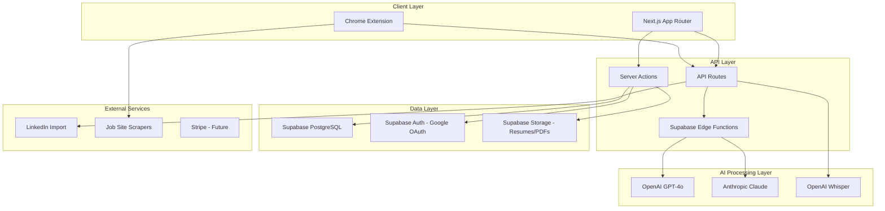
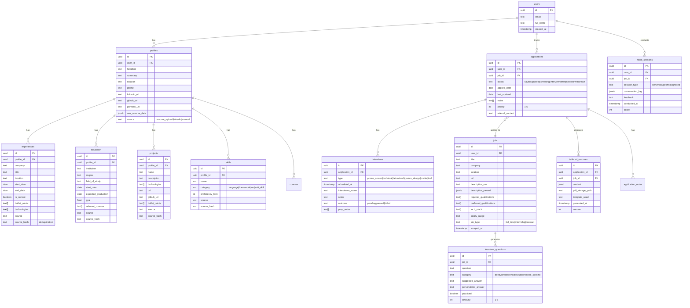
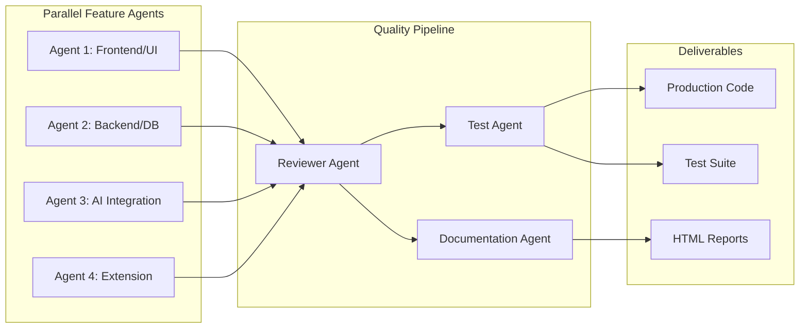

# HireVault - Comprehensive Project Plan

## Architecture Overview



---

## Tech Stack

| Layer | Technology |
|-------|-----------|

- **Frontend**: Next.js 14+ (App Router), React 18, TypeScript
- **Styling**: Tailwind CSS + shadcn/ui (Linear-inspired dark theme)
- **State**: Zustand (client) + React Query/TanStack Query (server state)
- **Database**: Supabase PostgreSQL with Row Level Security
- **Auth**: Supabase Auth (Google OAuth)
- **Storage**: Supabase Storage (resume uploads, generated PDFs)
- **AI - Text Generation**: Anthropic Claude (resume writing, interview coaching - superior writing quality)
- **AI - Analysis/Parsing**: OpenAI GPT-4o (resume parsing, job description analysis, structured data extraction)
- **AI - Voice**: OpenAI Whisper (speech-to-text for future voice features)
- **PDF Generation**: React-PDF / Puppeteer (for resume PDF export)
- **Browser Extension**: Chrome Manifest V3 (TypeScript, communicates with main app)
- **Deployment**: Vercel (frontend) + Supabase (backend services)
- **Monorepo**: Turborepo (shared types between app, extension, edge functions)

---

## Design System

- **Theme**: Dark mode primary (Linear-inspired), with light mode toggle
- **Colors**: Deep slate/zinc backgrounds, electric blue/violet accent colors, high contrast text
- **Typography**: Inter (UI) + JetBrains Mono (code/data)
- **Motion**: Framer Motion for transitions (subtle, purposeful animations like Linear)
- **Layout**: Sidebar navigation, command palette (Cmd+K), keyboard-first interactions
- **Data Viz**: Recharts for application pipeline visualization

---

## Database Schema (Core Tables)



---

## Feature Breakdown by Phase

### Phase 1: Foundation (Week 1-2)
Priority: Get the skeleton running with auth, profile, and data storage.

1. **Project scaffolding** - Turborepo monorepo with Next.js app, shared types package, extension package
2. **Supabase setup** - Database schema, RLS policies, auth configuration (Google OAuth)
3. **Design system** - shadcn/ui theme (Linear-dark), layout shell, sidebar nav, command palette
4. **Authentication flow** - Google OAuth login/signup, session management, protected routes
5. **Profile data model** - CRUD for experiences, education, projects, skills, courses

### Phase 2: Data Ingestion (Week 2-3)
Priority: Multiple ways to populate profile data with deduplication.

6. **Resume upload + AI parsing** - Upload PDF/DOCX, use GPT-4o to extract structured data, populate profile
7. **LinkedIn import** - OAuth or profile URL scraping to import professional data
8. **Manual entry forms** - Rich forms for each profile section with inline editing
9. **Deduplication engine** - Hash-based dedup across sources (union logic), conflict resolution UI
10. **Data validation + enrichment** - Verify parsed data, suggest improvements

### Phase 3: Job Tracking Dashboard (Week 3-4)
Priority: The command center for tracking all applications.

11. **Application pipeline board** - Kanban-style view (saved -> applied -> screening -> interview -> offer/rejected)
12. **Job entry** - Manual add + paste description + extension integration
13. **Application status management** - Drag-and-drop status changes, date tracking, notes
14. **Dashboard analytics** - Application velocity, response rates, pipeline visualization (Recharts)
15. **Search, filter, sort** - By company, status, date, priority, role type

### Phase 4: Browser Extension (Week 4-5)
Priority: Seamless job capture while browsing.

16. **Chrome extension scaffold** - Manifest V3, popup UI, content scripts
17. **Job page detection** - Detect when user is on a job listing (LinkedIn, Greenhouse, Lever, Workday, etc.)
18. **One-click capture** - Extract job title, company, description, requirements from the page
19. **Sync to HireVault** - Push captured job data to the main app via API
20. **Fallback paste** - If scraping fails, easy copy-paste modal in the extension

### Phase 5: AI Resume Tailoring (Week 5-7)
Priority: The core differentiator - generating targeted resumes.

21. **Job description analysis** - Parse JD into required qualifications, preferred qualifications, tech stack, keywords
22. **Experience matching engine** - Score each experience/project against JD requirements
23. **Resume content generation** - Use Claude to rewrite bullet points emphasizing JD-relevant skills
24. **ATS optimization** - Keyword density analysis, formatting compliance, parsability checks
25. **Resume templates** - One ATS-optimized default + 2-3 visual templates for human review
26. **In-app resume editor** - Live preview, drag-and-drop sections, inline content editing
27. **PDF export** - High-quality PDF generation matching template design
28. **Version history** - Track all generated resume versions per application

### Phase 6: Interview Preparation (Week 7-9)
Priority: Turn job descriptions into personalized interview prep.

29. **Question generation** - Analyze JD to generate behavioral, technical, and situational questions
30. **Personalized answer crafting** - Use Claude + user's profile data to draft answers that sound authentic
31. **Answer refinement** - User edits answers, AI helps make them more natural while keeping substance
32. **Practice mode** - Flash-card style question practice with self-rating
33. **Technical prep recommendations** - Identify tech stack gaps, suggest learning resources (docs, courses, tutorials)
34. **Company research integration** - Pull company info, recent news, values for behavioral prep

### Phase 7: Mock Interviews (Week 9-10)
Priority: Text-based mock interview sessions with AI feedback.

35. **Mock interview engine** - AI asks questions, user types answers, AI evaluates in real-time
36. **Scoring and feedback** - Rate answers on relevance, specificity, STAR method usage, authenticity
37. **Session history** - Track improvement over time, identify weak areas
38. **Role-specific modes** - Behavioral, technical (conceptual), system design discussion, case interview

### Phase 8: Coaching and Insights (Week 10-11)
Priority: Ongoing improvement recommendations.

39. **Profile strength analysis** - Score profile completeness, identify gaps
40. **Application strategy recommendations** - Suggest role types, companies, timing
41. **Interview performance trends** - Track mock interview scores over time
42. **Skill gap analysis** - Compare profile skills vs. market demand for target roles

---

## Multi-Agent Development Strategy



### Parallel Feature Agents
- **Agent 1 (Frontend/UI)**: Builds pages, components, layouts, interactions
- **Agent 2 (Backend/DB)**: Schema migrations, API routes, Edge Functions, RLS policies
- **Agent 3 (AI Integration)**: Prompt engineering, AI pipelines, parsing logic
- **Agent 4 (Extension)**: Browser extension development (independent codebase)

### Quality Pipeline Agents
- **Reviewer Agent**: Code review on each PR/feature branch (correctness, architecture, security, performance)
- **Test Agent**: Writes and runs tests, ensures coverage
- **Documentation Agent**: Generates HTML progress reports

### HTML Progress Reports

Each report (generated after a feature is complete) will include:

1. **Executive Summary** - What was built, in plain English
2. **Architecture Decisions (WHY)** - Explains reasoning behind every significant choice
3. **Files Changed** - Grouped by module, with descriptions of each file's purpose
4. **Code Walkthrough** - Key snippets with annotations explaining the logic
5. **Visual Diffs** - Before/after comparisons where relevant
6. **Data Flow Diagrams** - Mermaid diagrams showing how data moves through the feature
7. **Quality Metrics** - Test coverage, linting status, type safety, bundle size impact
8. **Risk Assessment** - Known limitations, potential issues, tech debt introduced
9. **Accountability Section** - Confidence ratings, known weaknesses, "break this" challenges, verification playbook, questions to ask (see QAS section below)
10. **Learning Section** - "Why this matters" explanations, "dig deeper" links, "modify this" exercises
11. **Mistake Postmortems** - Any bugs found since last report, with root cause and prevention
12. **Next Steps** - What builds on this feature, what's coming next

Reports will be styled HTML files with:
- Dark theme matching HireVault's aesthetic
- Collapsible sections for easy scanning
- Syntax-highlighted code blocks
- Interactive Mermaid diagrams
- Color-coded confidence indicators (green = high confidence, yellow = reservations, red = scrutinize)
- Table of contents with anchor links
- Expandable "Questions to Ask" panels
- Running mistake pattern summary (if any)

---

## Quality Accountability System (QAS)

The QAS is the structured process by which you (the human reviewer) verify code quality, catch mistakes, and learn from the codebase. It operates at three levels: automated gates (trust the tools, not me), structured reports (guided review), and pattern tracking (catching decay over time).

### Automated Quality Gates (Run Anytime, Trust the Output)

These are objective, machine-verifiable checks. They pass or fail regardless of what I claim:

- **TypeScript strict mode** (`"strict": true`) - Compiler catches type errors
- **ESLint** with `@typescript-eslint` - Enforces patterns and catches bugs
- **Prettier** - Consistent formatting (no debates)
- **Vitest test suite** - Unit + integration tests, minimum 80% coverage on business logic
- **Playwright E2E tests** - Critical user flows verified end-to-end
- **Lighthouse CI** - Performance/accessibility scores tracked per deploy
- **Bundle analyzer** - Alerts if client bundle exceeds budget
- **Supabase RLS tests** - Automated tests that prove auth policies work

Single command to run all gates: `pnpm quality:check` (outputs pass/fail for each gate with details)

### HTML Report Accountability Section

Every HTML progress report includes a dedicated accountability block with these subsections:

**1. Confidence Ratings**
Each implemented component/decision gets a confidence tag:
- GREEN (High) - "I'm confident this is correct and well-implemented"
- YELLOW (Medium) - "This works but I have reservations about [specific thing]"
- RED (Low) - "This was my best guess; please scrutinize this closely"

If every rating is GREEN, that itself is a yellow flag - it means I may not be self-aware about my limitations.

**2. Known Weaknesses and Uncertainties**
Explicit list of things that might be wrong, incomplete, or fragile. Written in plain language, e.g., "The deduplication hash doesn't account for slight spelling variations in company names - this could cause near-duplicates."

**3. Alternatives Rejected (and Why)**
For each major decision, at minimum one alternative approach that was considered and why it was rejected. If the rejection reasoning is weak (e.g., "it seemed harder"), that's a signal to push back.

**4. "Break This" Challenges**
Specific inputs, sequences, or edge cases you can try to break the feature. Example: "Try uploading a resume that's a scanned image PDF (not text-based). The parser will likely fail. Test with [specific file]."

**5. Verification Playbook**
Three-tier verification you can do:
- **2-Minute Check**: Run `pnpm quality:check`. Green = baseline met.
- **10-Minute Walkthrough**: Open [specific files listed], read [specific functions listed]. Do they make sense? Try [specific user flow].
- **Deep Dive**: Questions to ask me that will reveal if I cut corners (listed per feature).

**6. Questions You Should Ask Me**
Concrete questions tailored to the feature, e.g.:
- "What happens if the API rate limit is hit mid-resume-generation?"
- "Show me the test that proves RLS blocks user A from seeing user B's data."
- "Why is this state in Zustand instead of server state?"

If I can't answer clearly, that's a problem.

### Mistake Tracking and Postmortems

**Per-Mistake Postmortem** (appended to the next report after a bug is found):
- What went wrong (the symptom)
- Root cause (why it happened)
- How it was fixed
- What should have caught it (missing test? insufficient review?)
- Prevention measure added (new test, new lint rule, etc.)

**Pattern Tracker** (cumulative across all reports):
A running table in `reports/mistake-tracker.md` tracking:
- Date, feature, mistake category (logic error, type error, missing edge case, performance, security, etc.)
- Severity (cosmetic / functional / data-loss-risk)
- Was it caught by automated gates? (if not, why not?)
- Recurring patterns highlighted with a count

If the same category appears 3+ times, it triggers a **systemic fix** - a new lint rule, a new test pattern, or a process change to prevent the entire class of error.

### Red Flag Indicators (What to Look For)

When reviewing code, these are signals that quality may be compromised:
- `any` type in TypeScript (type safety bypassed)
- `// TODO` without a linked issue or timeline
- Functions longer than 40 lines (likely doing too much)
- No error handling on async operations
- Commented-out code left in (indicates indecision)
- Magic numbers without constants/explanation
- Missing loading/error states in UI components
- No test file alongside a utility/hook file
- Console.log statements left in production code
- Overly complex abstractions for simple problems (over-engineering)

### Learning Integration

Since you're intermediate-level and know programming but not all specific technologies:

- **"Why This Matters" Callouts** - In reports, key patterns are explained at the conceptual level (not "what is a hook" but "why useCallback here prevents a re-render cascade that would freeze the Kanban board")
- **"Dig Deeper" Links** - Official documentation links for patterns used, so you can verify my approach matches best practices
- **"Modify This" Exercises** - Small suggested changes you can make to build intuition (e.g., "Try removing the `useMemo` on line 47 of `ResumeEditor.tsx` and watch what happens to render performance in React DevTools")

---

## Project Structure

```
hirevault/
├── apps/
│   ├── web/                    # Next.js main application
│   │   ├── app/               # App Router pages
│   │   │   ├── (auth)/        # Auth pages (login, callback)
│   │   │   ├── (dashboard)/   # Protected dashboard pages
│   │   │   │   ├── overview/
│   │   │   │   ├── profile/
│   │   │   │   ├── applications/
│   │   │   │   ├── jobs/
│   │   │   │   ├── resumes/
│   │   │   │   ├── interviews/
│   │   │   │   ├── mock/
│   │   │   │   └── settings/
│   │   │   ├── api/           # API routes
│   │   │   └── layout.tsx
│   │   ├── components/        # React components
│   │   │   ├── ui/            # shadcn/ui primitives
│   │   │   ├── layout/        # Shell, sidebar, nav
│   │   │   ├── profile/       # Profile-related components
│   │   │   ├── applications/  # Application tracking components
│   │   │   ├── resume/        # Resume editor/viewer
│   │   │   ├── interview/     # Interview prep components
│   │   │   └── shared/        # Shared/common components
│   │   ├── lib/               # Utilities, hooks, stores
│   │   │   ├── supabase/      # Supabase client, helpers
│   │   │   ├── ai/            # AI provider clients
│   │   │   ├── hooks/         # Custom React hooks
│   │   │   └── stores/        # Zustand stores
│   │   └── styles/            # Global styles, theme
│   └── extension/             # Chrome extension
│       ├── manifest.json
│       ├── popup/             # Extension popup UI
│       ├── content/           # Content scripts (job page detection)
│       ├── background/        # Service worker
│       └── shared/            # Shared utilities
├── packages/
│   ├── types/                 # Shared TypeScript types
│   ├── ai-core/              # AI pipeline logic (shared between app + edge functions)
│   ├── resume-templates/     # Resume template definitions
│   └── supabase/             # Supabase schema, migrations, seed data
│       ├── migrations/
│       ├── functions/         # Edge Functions
│       └── seed.sql
├── reports/                   # HTML progress reports
├── turbo.json
├── package.json
└── README.md
```

---

## Key Technical Decisions (WHY)

1. **Turborepo monorepo** - Shared types between web app, extension, and edge functions prevent drift. Single source of truth for the data model.

2. **Supabase over custom backend** - Gives us auth, database, storage, edge functions, and real-time subscriptions out of the box. Dramatically reduces time-to-MVP for a 1-3 month timeline.

3. **Claude for writing, GPT-4o for parsing** - Claude produces more natural, human-sounding text (critical for resumes and interview answers). GPT-4o excels at structured data extraction and follows JSON schemas reliably.

4. **App Router (not Pages)** - Server Components reduce client bundle, Server Actions simplify data mutations, streaming enables progressive AI response rendering.

5. **Zustand over Redux** - Minimal boilerplate, perfect for the limited client state we need (most state is server-side via TanStack Query).

6. **Chrome Extension (Manifest V3)** - Despite scraping challenges, a browser extension provides the smoothest UX for job capture. Content scripts can access the rendered DOM that APIs cannot.

7. **Hash-based deduplication** - Generating a content hash (normalized company + title + date range) for each experience/project entry allows merging data from resume upload, LinkedIn, and manual entry without creating duplicates.

8. **PDF generation via React-PDF** - Keeps resume rendering in React (consistent with the rest of the app), allows live preview and export from the same component tree.

---

## Immediate First Steps

1. Initialize Turborepo monorepo with Next.js app
2. Configure Supabase project (schema, auth, storage)
3. Set up shadcn/ui with Linear-dark theme
4. Build the authentication flow (Google OAuth)
5. Create the dashboard shell (sidebar, layout, command palette)
6. Generate first HTML progress report
