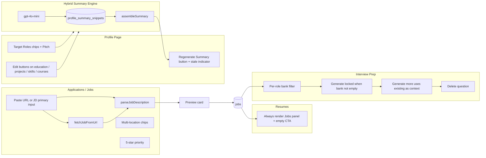
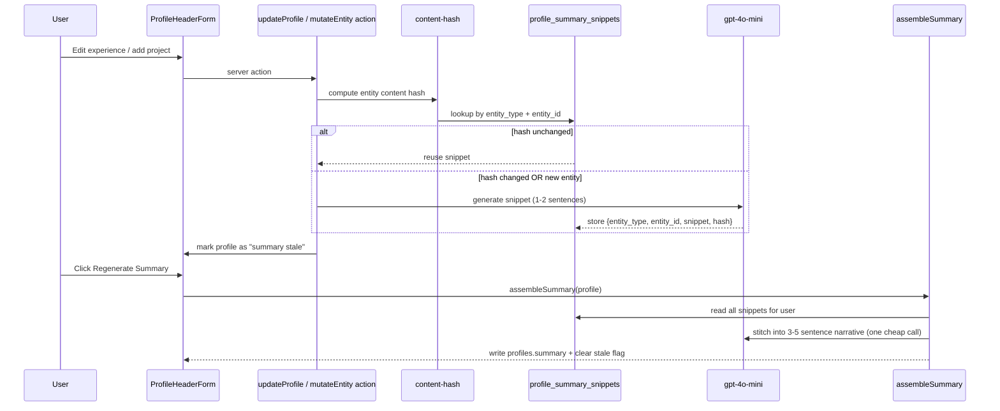

# HireVault — Refinement Iteration 1

## Goals

Address every item in your feedback while keeping AI spend disciplined. Each fix is justified by a specific file/component identified in the current codebase.

## Decisions Locked In

- **Headline replacement**: Drop the single Headline UI; replace with **Target Roles** (chip array) + optional **Personal Pitch** (1-line free text). Both feed downstream tailoring/interview prompts. Keep the `headline` DB column for backward compatibility but stop surfacing it.
- **Bullet auto-format**: Import-time only (resume parse + LinkedIn import). Manual entries are trusted. No per-save AI spend.
- **Summary**: Hybrid (snippet-per-entity cache + assembled summary). Manual "Regenerate Summary" button + "Profile changed" indicator. Auto-regenerate the assembled summary only when an entity is added or removed (not on minor edits).
- **Question bank**: Per-role, persistent, gated. "Generate more" locked until all current questions rated; passes existing questions as context to fill JD gaps; per-question delete.
- **Defaults applied (override before exec if desired)**: paste URL OR JD → preview → save; best-effort fetch + JD-paste fallback; multi-location free-text chips; 5-star priority UI; `gpt-4o-mini` for summaries; any self-rating counts as practiced.

---

## Architecture Diagram (changed surfaces only)

---

## Phase A — Profile Page

### A1. Edit-everywhere consistency

Refactor `SectionList` to support per-row editing via a render-prop, or split into typed row components matching `ExperienceRow`. The server actions already exist (`updateEducation`, `updateProject`, `updateSkill` in [apps/web/lib/profile/actions.ts](apps/web/lib/profile/actions.ts)) but are unused. Add `updateCourse` to match.

- Update [apps/web/components/profile/section-list.tsx](apps/web/components/profile/section-list.tsx) to take an optional `onEdit` render prop, OR create `EducationRow.tsx`, `ProjectRow.tsx`, `SkillRow.tsx`, `CourseRow.tsx` mirroring [apps/web/components/profile/experience-row.tsx](apps/web/components/profile/experience-row.tsx). Recommendation: **split into row components** — cleaner type safety, fewer special cases.
- Wire each section in [apps/web/app/(dashboard)/profile/page.tsx](apps/web/app/(dashboard)/profile/page.tsx) to its new row component.

### A2. Replace Headline UI with Target Roles + Pitch

- Migration: add `target_roles text[] not null default '{}'` and `pitch text` to `profiles`. Keep `headline` column (read-only / hidden).
- Update [apps/web/components/profile/profile-header-form.tsx](apps/web/components/profile/profile-header-form.tsx):
  - Remove the Headline `<Input>`.
  - Add a chip multi-select for Target Roles with curated suggestions (`AI Engineer`, `SWE`, `Quant Dev`, `PM`, `Tech Consulting`) + free-text add.
  - Add a single-line `pitch` input with placeholder text like "One sentence that captures your professional thesis".
- Update `updateProfile` server action in [apps/web/lib/profile/actions.ts](apps/web/lib/profile/actions.ts) to accept `target_roles` (split-by-comma form value) and `pitch`.
- Pass `target_roles` and `pitch` into all downstream prompts (resume tailoring in [packages/ai-core/src/resume.ts](packages/ai-core/src/resume.ts), interview question generation in [packages/ai-core/src/interviews.ts](packages/ai-core/src/interviews.ts), summary assembler).

### A3. Hybrid AI Summary system

- Migration: new table
  - `profile_summary_snippets(id, profile_id, entity_type, entity_id, snippet text, source_hash text, model text, generated_at, unique(profile_id, entity_type, entity_id))`
  - Add `summary_stale boolean default false`, `summary_assembled_at timestamptz` to `profiles`.
- New module [packages/ai-core/src/summary.ts](packages/ai-core/src/summary.ts):
  - `generateSnippet(entity)` — uses `gpt-4o-mini` via the existing OpenAI client in [packages/ai-core/src/parse.ts](packages/ai-core/src/parse.ts). Output 1–2 sentences, ~25 words.
  - `assembleSummary(snippets, profile)` — single cheap call to stitch into a 3–5 sentence narrative.
  - `entityHash(entity)` — deterministic stringify-then-sha256 of normalized entity fields.
- New server actions in [apps/web/lib/profile/summary.ts](apps/web/lib/profile/summary.ts):
  - `regenerateSnippet(entity_type, entity_id)` — invoked by each create/update action ONLY if the hash changed.
  - `assembleProfileSummary()` — manual trigger from UI button.
  - Auto-call `assembleProfileSummary` only on entity add/delete (not field edits).
- Wire into existing server actions: `createExperience`, `updateExperience`, `deleteExperience`, etc. in [apps/web/lib/profile/actions.ts](apps/web/lib/profile/actions.ts) — call `regenerateSnippet` and set `summary_stale = true`. On `delete*`, drop the snippet row and set stale.
- UI: in [apps/web/components/profile/profile-header-form.tsx](apps/web/components/profile/profile-header-form.tsx) replace the manual `summary` `<Textarea>` with a read-only display of the assembled summary + a "Regenerate" button + a small "Profile changed since last assembly" pill when `summary_stale` is true.

### A4. Bullet auto-formatting on import

- Add `polishBullets(bullets, role)` in [packages/ai-core/src/write.ts](packages/ai-core/src/write.ts) (uses Claude Haiku — already cheap; or fallback to gpt-4o-mini). Returns a normalized list (action verb start, single sentence, quantified where possible).
- Hook into resume parse (`parseResumeText` in [packages/ai-core/src/parse.ts](packages/ai-core/src/parse.ts)) and the LinkedIn import path so bullets pass through `polishBullets` before being written to the DB.
- Manual entries via `createExperience` / `updateExperience` are NOT polished.

---

## Phase B — Applications / Jobs Page

### B1. Streamlined add flow (paste URL or JD)

Replace the current 7-field form in [apps/web/components/applications/add-application-form.tsx](apps/web/components/applications/add-application-form.tsx) with a two-tab card:

- **Tab 1 (default): Smart capture** — single textarea labeled "Paste a job URL or the JD text". Submit → server action `parseAndPreviewJob(input)`:
  - If input matches URL regex → call new `fetchJobFromUrl(url)` (best-effort `fetch` + readability extraction; pluggable per-domain selectors for Greenhouse, Lever, Ashby, Workday).
  - If fetch returns empty/blocked → return `{ blocked: true, fallbackHint }`.
  - Pass extracted text (or pasted JD) into existing `parseJobDescription` ([packages/ai-core/src/parse.ts](packages/ai-core/src/parse.ts)).
  - Render a preview card (title / company / locations / tech stack / required quals) with editable fields.
- **Tab 2: Manual** — keeps current form for fallback.
- Saving from preview calls existing `createJob` + `createApplication` in [apps/web/lib/applications/actions.ts](apps/web/lib/applications/actions.ts).
- New file [apps/web/lib/applications/scrape.ts](apps/web/lib/applications/scrape.ts) implements `fetchJobFromUrl` with a per-domain selector map and a generic readability fallback. No headless browser.

### B2. Multi-location

- Migration: add `locations text[] not null default '{}'` to `jobs`. Keep `location text` for now and copy first chip in for backward compatibility.
- Update [apps/web/lib/applications/actions.ts](apps/web/lib/applications/actions.ts) `createJob` and `parseJobDescription` to write `locations`.
- Update job display in [apps/web/app/(dashboard)/jobs/page.tsx](apps/web/app/(dashboard)/jobs/page.tsx) and the application card to render chips.
- Update parse schema in [packages/ai-core/src/schemas.ts](packages/ai-core/src/schemas.ts) so the AI returns `locations: string[]`.

### B3. 5-star priority

- Replace numeric input in `add-application-form.tsx` and any application edit UI with a `StarRating` component (5 stars, click to set, hover preview). 5 stars = highest.
- Schema unchanged: still stores int 1–5 in `applications.priority`.
- Add helper text "More stars = higher priority" under the row.

---

## Phase C — Resumes Page Fix

In [apps/web/components/resumes/resume-workspace.tsx](apps/web/components/resumes/resume-workspace.tsx), the early return at lines 78–86 hides the Jobs sidebar when there are zero resumes. Fix:

- Remove the early return. Always render the two-column layout.
- When `resumes.length === 0`, show an empty-state card in the right column with text like "Pick a job on the left to generate your first tailored resume" and a small graphic/illustration.
- When `jobs.length === 0`, the left column shows "No jobs saved yet — add one from the Applications page" with a link to `/applications`.

---

## Phase D — Interview Prep Page

### D1. Per-role bank with proper filtering

In [apps/web/components/interviews/interview-prep.tsx](apps/web/components/interviews/interview-prep.tsx):

- The "Question bank" section at lines 203–218 currently shows ALL questions (every job). Filter by `jobId` to match the selected role.
- Hide the bank entirely when no role is selected.

### D2. Gating for generation

- "Generate questions" button: disable if `jobQuestions.length > 0`. Replace its label with "Generate more" once questions exist.
- "Generate more": disable until every question in the current bank has `practice_rating != null` OR `practiced = true`. Show a tooltip explaining the gate ("Rate all current questions before generating more").

### D3. Generation that fills gaps

- Update `generateInterviewQuestions` in [packages/ai-core/src/interviews.ts](packages/ai-core/src/interviews.ts) to accept an optional `existingQuestions: string[]` parameter and instruct the prompt to:
  - avoid duplicating semantics of existing questions
  - target uncovered parts of the JD (job_responsibilities, preferred quals not yet probed, tech stack items not yet asked about).
- Update `generateQuestionsForJob` in [apps/web/lib/interviews/actions.ts](apps/web/lib/interviews/actions.ts) to pass the existing questions for the role.

### D4. Per-question delete

- New server action `deleteQuestion(questionId)` in [apps/web/lib/interviews/actions.ts](apps/web/lib/interviews/actions.ts).
- Add a small trash button on each row of the question bank.

---

## Phase E — Quality, Tests, Iteration Report

### E1. Tests (Vitest)

Add to [packages/ai-core/src](packages/ai-core/src):

- `summary.test.ts` — `entityHash` is stable across whitespace; `assembleSummary` joins snippets and produces ≤ 5 sentences.
- `scrape.test.ts` (in `apps/web/lib/applications`) — URL detection regex; selector map handles a sample Greenhouse HTML fixture; falls back gracefully on empty body.
- `interviews.test.ts` — duplicate-avoidance prompt includes existing questions verbatim.
- Lock the existing `pnpm quality:check` to also include these new files.

### E2. HTML iteration report

Generate [reports/refinement-1.html](reports/refinement-1.html) matching the look of [reports/phase-4-8-complete.html](reports/phase-4-8-complete.html):

- Same dark theme, Mermaid CDN, sticky TOC, collapsible `<section>` cards.
- Sections in order: Executive Summary; Architecture WHY (table linking to per-phase notes); Files Changed (grouped by package/app); Code Walkthrough (key snippets for the snippet engine, scrape, gating); Mermaid Diagrams (the two diagrams in this plan); Quality Metrics (Vitest results, typecheck, lint, build); **Accountability** (confidence ratings, known weaknesses, alternatives rejected, "break this" challenges, verification playbook, questions to ask me); **Mistake Postmortems** for any bugs caught during this iteration; "Next Steps".
- Add an entry in [reports/mistake-tracker.md](reports/mistake-tracker.md) for the resumes empty-state regression and the interview-bank cross-job leakage (both pre-existing, now fixed).
- A short "Decisions Locked In" panel at the top showing the answers from the alignment round so future agents can see context without re-reading this plan.

---

## Files Most Likely to Change

- DB: `packages/supabase/migrations/<timestamp>_refinement_iteration_1.sql` (new)
- AI core: `packages/ai-core/src/summary.ts` (new), `parse.ts`, `write.ts`, `interviews.ts`, `schemas.ts`, plus tests
- Web — profile: `components/profile/section-list.tsx` (refactor or split), new row components for education/projects/skills/courses, `components/profile/profile-header-form.tsx`, `lib/profile/actions.ts`, new `lib/profile/summary.ts`
- Web — applications: `components/applications/add-application-form.tsx` (rewritten), new `components/applications/job-preview-card.tsx`, new `lib/applications/scrape.ts`, `lib/applications/actions.ts`, new `components/ui/star-rating.tsx`, `components/applications/application-card.tsx`
- Web — resumes: `components/resumes/resume-workspace.tsx`
- Web — interviews: `components/interviews/interview-prep.tsx`, `lib/interviews/actions.ts`
- Reports: `reports/refinement-1.html`, `reports/mistake-tracker.md`

## Out of Scope (deferred)

- Voice mock interviews (already deferred per original plan).
- Stripe billing (`freemium_later` decision).
- Browser extension changes — current extension is unaffected; `paste URL` becomes a parallel entry point in-app.

## Verification Plan (for you, after exec)

1. Run `pnpm quality:check` — must pass typecheck, lint, Vitest, build.
2. Profile page: edit one entry from each tab; confirm Regenerate Summary works; confirm Target Roles + Pitch save and persist.
3. Applications page: paste a Greenhouse URL; confirm preview; save. Then paste raw JD text; confirm preview; save. Try a known-blocked URL (LinkedIn) and confirm you get a clear fallback message.
4. Resumes page with zero resumes: confirm jobs panel is visible with at least one job, click to tailor, confirm flow.
5. Interview prep: select a role; confirm bank only shows that role's questions; rate all; confirm "Generate more" unlocks; confirm new questions don't duplicate existing; delete one.
6. Open `reports/refinement-1.html` in a browser; verify all sections render and Mermaid diagrams display.

