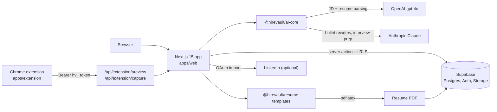

# HireVault

[](https://github.com/MaximusAnax/hire-vault/actions/workflows/quality.yml)

HireVault is a career command center. It captures job postings from the browser, tracks each application, tailors a LaTeX resume to the job description, and prepares you for the interview.

## What it does

- **Capture.** A Chrome MV3 extension scrapes the job posting on the current tab, shows an editable preview and saves it to your pipeline. You can also paste a URL or a job description in the web app.
- **Track.** Applications appear on a Kanban board or in a list, with filters, priority, role timing and a "Needs review" inbox for quick captures.
- **Profile.** You keep one master profile (experience, education, projects, leadership, skills, courses). It can be imported from a resume (PDF or DOCX) or from LinkedIn. Imports go through a preview-and-confirm step with dedup and conflict resolution.
- **Tailor.** For each application, HireVault scores your experiences against the job description, rewrites the strongest bullets with Claude, computes a keyword-coverage ATS score and gap list, and compiles a PDF from LaTeX templates.
- **Prep.** It generates interview questions for each job and lets you draft, refine and rate your answers.
- **Overview.** A ranked action queue shows what to do next (screening prep, untailored resumes, import conflicts, items waiting for review), alongside weekly application velocity against a goal you set.

## Architecture



Server Components read through `lib/<domain>/queries.ts` and mutate through `"use server"` actions in `lib/<domain>/actions.ts`. Row-level security is enabled in the Supabase migrations. The service-role key is used only by the extension token flow (issuing tokens, verifying them, saving captures). Tokens start with `hv_` and are stored as SHA-256 hashes. LinkedIn OAuth tokens are encrypted with AES-256-GCM before storage.

## Tech stack

- **Monorepo:** Turborepo + pnpm workspaces, TypeScript throughout
- **Web:** Next.js 15 (App Router), React 19, Tailwind CSS, Radix/shadcn primitives, TanStack Query, Zustand, Recharts, cmdk
- **Data:** Supabase (Postgres with RLS, Google OAuth, Storage for PDFs), with SQL migrations in `packages/supabase`
- **AI:** OpenAI `gpt-4o` for resume and JD parsing; Anthropic Claude Sonnet for rewrites and answers and Haiku for optional import polish. Both are optional, and features degrade gracefully without keys.
- **Documents:** `pdf-parse` and `mammoth` for import; LaTeX (`pdflatex`) for export
- **Extension:** Chrome Manifest V3, bundled with esbuild
- **Quality:** Vitest unit tests, ESLint, and a GitHub Actions `quality` workflow that runs typecheck, lint, test and build

## Structure

| Path | Purpose |
|------|---------|
| `apps/web` | Next.js 15 App Router (main product) |
| `apps/extension` | Chrome MV3 job capture extension |
| `packages/ai-core` | Zod parsing schemas, OpenAI/Claude calls, resume scoring, interview generation, dedup hashes |
| `packages/resume-templates` | LaTeX resume templates + `pdflatex` compile |
| `packages/types` | Shared TypeScript types |
| `packages/supabase` | SQL migrations, seed |
| `packages/orchestrator` | Cursor SDK builder/tester loop used during development (archived) |
| `docs/` | Product, state, navigation, setup, decisions |
| `scripts/db.sh` | Forward-only Supabase CLI wrapper that blocks destructive commands |

## Prerequisites

| Tool | Version | Notes |
|------|---------|-------|
| **Node.js** | 20.x (see `.nvmrc`) or 22.x | `package.json` engines: `>=20 <23` |
| **pnpm** | **9.15.0** (pinned) | Do **not** run bare `npx pnpm`. It installs pnpm 11+, which requires Node ≥ 22.13 and `node:sqlite`. |
| **pdflatex** | any TeX distribution | Optional. Needed only for resume PDF export |
| **Supabase CLI** | latest | Optional. Used by `pnpm db` for migrations |

**Use the repo’s pnpm version:**

```bash
nvm use
corepack enable
corepack prepare pnpm@9.15.0 --activate
# Or: npx pnpm@9.15.0 install
```

## Quick start

### 1. Install dependencies

```bash
pnpm install
```

### 2. Supabase project

1. Create a project at [supabase.com](https://supabase.com).
2. Apply the migrations in `packages/supabase/migrations/`, either in the SQL Editor or with `pnpm db db push` (see [docs/setup/database.md](docs/setup/database.md)).
3. Enable **Google OAuth**: [docs/setup/auth-google-oauth.md](docs/setup/auth-google-oauth.md).

### 3. Environment

All secrets live in a **single `.env` at the repo root**. Do not use `apps/web/.env.local`.

```bash
cp .env.example .env
```

| Variable | Required | Purpose |
|----------|----------|---------|
| `NEXT_PUBLIC_SUPABASE_URL`, `NEXT_PUBLIC_SUPABASE_ANON_KEY` | Yes | Supabase project and client auth |
| `NEXT_PUBLIC_APP_URL` | Yes | App origin (default `http://localhost:3000`) |
| `SUPABASE_SERVICE_ROLE_KEY` | Yes | Extension capture API (server only) |
| `OPENAI_API_KEY` | No | Resume and JD parsing (`gpt-4o`) |
| `RESUME_IMPORT_POLISH` | No | `1` enables Claude Haiku bullet polish after resume import |
| `ANTHROPIC_API_KEY` | No | Bullet rewrites, interview questions and answers |
| `LINKEDIN_CLIENT_ID`, `LINKEDIN_CLIENT_SECRET`, `LINKEDIN_REDIRECT_URI` | No | LinkedIn OAuth import ([setup](docs/setup/auth-linkedin-oauth.md)) |
| `LINKEDIN_TOKEN_ENCRYPTION_KEY`, `LINKEDIN_OAUTH_INCLUDE_PLUS_SCOPES` | No | Token encryption key override; opt-in to LinkedIn Plus scopes |
| `CURSOR_API_KEY` | No | Only for the archived orchestrator package |
| `SUPABASE_ACCESS_TOKEN`, `SUPABASE_DB_PASSWORD` | No | Supabase CLI migrations |
| `ALLOW_DEV_DATA_RESET` | No | `1` allows "Clear all my data" in production builds |
| `LATEX_COMPILER` | No | Path to `pdflatex` if it is not on `PATH` |

Details: [docs/setup/environment.md](docs/setup/environment.md).

### 4. Run the dev server

```bash
pnpm dev
```

Open [http://localhost:3000](http://localhost:3000) and sign in with Google at `/login`.

### 5. Load the extension (optional)

```bash
pnpm --filter @hirevault/extension build
```

Load `apps/extension/dist` as an unpacked extension in `chrome://extensions`. Then generate a token in **Settings → Chrome extension** and paste the app URL and the token into the popup. See [apps/extension/README.md](apps/extension/README.md).

## Scripts

| Command | Description |
|---------|-------------|
| `pnpm dev` | Start all apps (web on :3000) |
| `pnpm build` | Production build |
| `pnpm lint` | ESLint across workspace |
| `pnpm typecheck` | TypeScript check |
| `pnpm test` | Vitest |
| `pnpm quality:check` | typecheck + lint + test + build (same as CI) |
| `pnpm db <args>` | Supabase CLI wrapper, for example `pnpm db db push` |

## Status and limitations

The capture → track → tailor → prep loop works end to end and runs locally against your own Supabase project. The CI `quality` workflow runs typecheck, lint, tests and build on every push and pull request. [docs/STATE.md](docs/STATE.md) has the current routes and known gaps, including:

- **PDF export needs a TeX install.** It requires `pdflatex` on the host, so it works where a TeX distribution is installed and is local-first.
- **The ATS score is a heuristic.** It measures keyword density against the job description and does not simulate a vendor ATS.
- **Scrapers can break.** The extension scrapers depend on job-board DOM structure. A page-dump fallback and manual paste cover failures.
- **Company research is a stub.** Company research in interview prep is minimal.
- **LinkedIn OAuth needs app approval.** It depends on LinkedIn app approval and member API scopes. JSON paste import is the fallback.
- **There is no hosted deployment.** Run it locally against your own Supabase project.

## Documentation

- [docs/README.md](docs/README.md): documentation hub
- [docs/PRODUCT.md](docs/PRODUCT.md): vision, user loop, scope
- [docs/STATE.md](docs/STATE.md): shipped routes, flows, env, known gaps
- [docs/NAVIGATION.md](docs/NAVIGATION.md): code map and data flows
- [docs/decisions/](docs/decisions/): architecture decisions by phase
- [AGENTS.md](AGENTS.md): conventions for coding agents working in this repo

Development history: early milestones were built with a Cursor SDK builder/tester loop (`packages/orchestrator`), gated on `pnpm quality:check`. Its milestone specs, verdicts and phase reports are kept in [docs/archive/](docs/archive/README.md) for reference. They are historical and may describe features that were later removed.

## License

[MIT](LICENSE)
