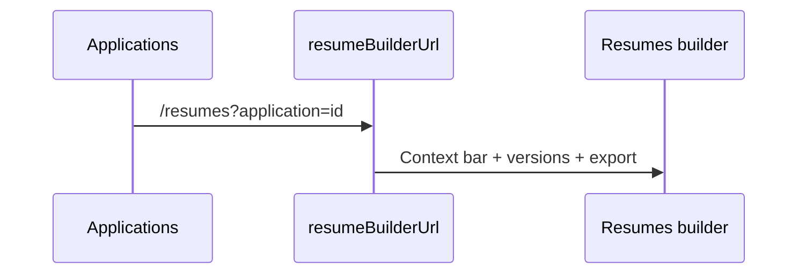
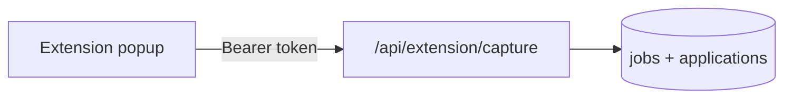

# Codebase navigation

## Monorepo layout

| Path | Package | Role |
|------|---------|------|
| `apps/web` | — | Next.js 15 App Router (main product) |
| `apps/extension` | — | Chrome MV3 job capture |
| `packages/types` | `@hirevault/types` | Shared TypeScript types |
| `packages/ai-core` | `@hirevault/ai-core` | AI schemas, parsing, resume scoring, interviews |
| `packages/resume-templates` | `@hirevault/resume-templates` | LaTeX → PDF |
| `packages/supabase` | — | SQL migrations, seed |
| `packages/orchestrator` | `@hirevault/orchestrator` | Agent build loop (archived milestones) |

## apps/web

### App router

```
app/
  (dashboard)/
    overview/page.tsx
    profile/page.tsx
    applications/page.tsx    # board | list via ?view=
    resumes/page.tsx         # index | builder via ?application=
    interviews/page.tsx
    settings/page.tsx
  api/extension/capture/route.ts
  auth/callback/route.ts
```

### Lib by domain

| Domain | Queries | Actions | Notes |
|--------|---------|---------|-------|
| Applications | `lib/applications/queries.ts` | `lib/applications/actions.ts` | Kanban, filters, job CRUD |
| Resumes | `lib/resumes/queries.ts` | `lib/resumes/actions.ts` | Tailor, PDF, summaries |
| Profile | — | `lib/profile/actions.ts` (+ `lib/profile/actions/*`) | Entity CRUD |
| Interviews | `lib/interviews/queries.ts` | `lib/interviews/actions.ts` | Question bank |
| Extension | — | `lib/extension/auth.ts`, `merge-capture-fields.ts` | Token verify |
| Ingestion | — | `lib/ingestion/actions.ts` | Resume upload parse |

**Pattern:** Server Components fetch in `page.tsx`; client components call server actions.

### Components

```
components/
  applications/   # kanban, list, filters, cards
  resumes/      # workspace, picker, badges
  profile/      # forms, rows
  interviews/   # prep UI
  layout/       # sidebar, shell, command palette
  ui/           # shadcn primitives
```

## User flows

### Applications → Resumes



Helper: `apps/web/lib/resumes/urls.ts`

### Extension capture



Scrapers: `apps/extension/src/content/scrapers*.ts`

## packages/ai-core

| Module | Purpose |
|--------|---------|
| `parse.ts` | JD parsing (OpenAI) |
| `write.ts` | Bullet rewrite (Anthropic) |
| `resume.ts` | Experience scoring, ATS heuristic |
| `interviews.ts` | Question generation |
| `schemas.ts` | Zod types including `ResumeContent` |

## packages/resume-templates

- `src/latex.ts` — build TeX from profile + tailored content
- `templates/resume-preamble.tex` — sb2nov layout
- `renderResumePdf()` — shell out to `pdflatex`

## packages/supabase

- Migrations: `migrations/*.sql` (source of truth)
- Setup: [setup/database.md](setup/database.md)

## Where to change X

| Task | Start here |
|------|------------|
| New application field | migration → `packages/types` → `application-card.tsx` |
| Resume tailor logic | `lib/resumes/actions.ts`, `packages/ai-core/src/resume.ts` |
| Extension scraper | `apps/extension/src/content/scrapers.ts` |
| New dashboard page | `app/(dashboard)/`, `components/layout/sidebar.tsx` |
| Auth / RLS issue | migrations, `lib/supabase/server.ts` |
