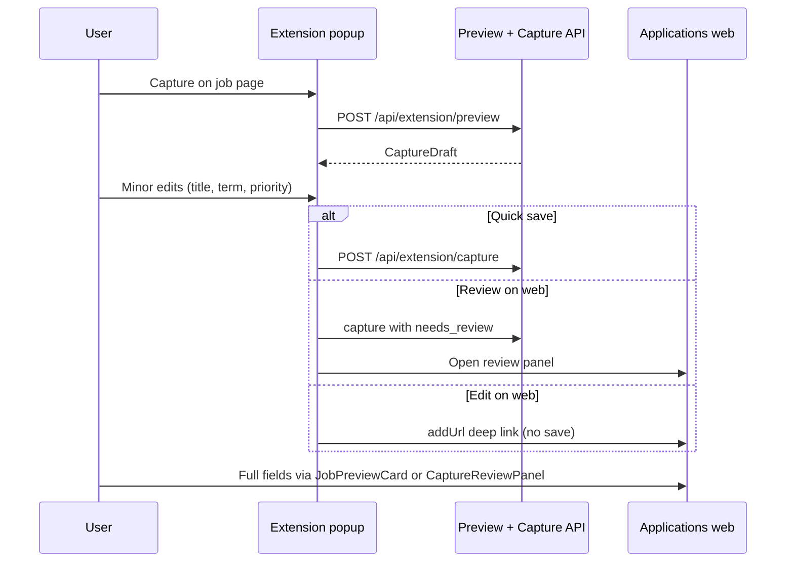

# Application Capture Evolution (ideation one-pager)

**North star:** 90%+ of extension captures need zero manual cleanup on the Applications board for intern/new-grad users applying at volume.

## Target flow

**In scope:** Extension popup preview (minor edits), shared parse/merge pipeline, capture API save-with-edited-fields, web review inbox, JD prompt hardening, light profile-fit hints.

**Out of scope:** Job curation/recommendations, autonomous apply, Chrome-only side panel (reverted for cross-browser portability).

## Parallel streams (shipped)

| Stream | Outcome |
|--------|---------|
| **Gate 0** | `CaptureDraft` type + JSON fixture |
| **A — API core** | Fix merge logic, `buildCapturePreview`, preview + capture routes |
| **B — AI parse** | Harden `JD_PARSE_USER` for intern cohorts |
| **C — Schema** | `applications.needs_review`, `capture_source` |
| **D — Extension** | Popup smart capture + dual web handoff |
| **E — Web inbox** | `capture-review-panel`, filter, `markApplicationReviewed`, overview action |
| **F — Fit hint** | `deriveCaptureFitHint` on web preview |

## Explicitly not doing

| Item | Reason |
|------|--------|
| Chrome side panel | Chrome-only API; popup is portable across Chromium browsers |
| Job recommendations / discovery | Out of product scope |
| Autonomous apply | Out of product scope |
| `responsibilities[]` DB columns | Defer until proven useful |

## Manual QA checklist

1. Extension popup capture → correct title/term → Save → board tile needs no edit.
2. **Review on web** → row in capture inbox → Mark reviewed clears flag.
3. **Edit on web** → `?addUrl=` opens full JobPreviewCard without duplicate until user saves.
4. Popup save preserves AI-parsed quals/tech (minor edit merge does not wipe arrays).
