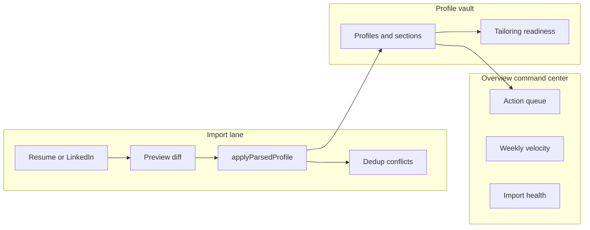

# Profile & Overview Evolution (ideation one-pager)

**North star:** Get new grads and early-career users from signup to a **tailored resume in under 15 minutes**, with a trustworthy profile vault and an Overview that answers **“what do I do next?”** without sidebar hopping.

## Target architecture

**Guardrail:** Preview and apply share one implementation — `planSectionUpsert()` in `merge-core` — so users never see a plan that apply ignores.

## Streams (shipped S0–S6, gated by S7)

| Stream | Outcome |
|--------|---------|
| **S0** | Shared types (`MergeStrategy`, `PreviewSummary`, `OverviewAction`); migrations; `merge-core` |
| **S1** | Import preview gate UI + `previewParsedProfile` / `confirmIngestionRun` |
| **S2** | `newest_wins` merge default, manual-row protection, bullet union on parse, conflict UI |
| **S3** | Overview data layer + `deriveOverviewActions()` + tests |
| **S4** | Action queue, velocity widget, import health badge on `/overview` |
| **S5** | Tailoring readiness, profile summary, campus-friendly profile UX |
| **S6** | LinkedIn OAuth routes, `linkedin_connections`, API mapper; sync through preview gate |
| **S7** | `pnpm quality:check`, docs, manual QA script |

## Explicitly not doing

| Item | Reason |
|------|--------|
| Coaching insights panel | Out of scope per [PRODUCT.md](../PRODUCT.md) |
| Full resume builder embedded in Overview | Deep-link to `/resumes` only |
| LinkedIn scrape via extension | Official API + OAuth |
| Story inventory / bullet tagging | Deferred past profile UX phase |
| Orbit network integration | Future context only |
| Profile completeness gamification | Wrong metric vs time-to-apply |
| Auto-apply | Out of product scope |

## Manual QA checklist (S7)

1. Upload resume → preview bucket counts match DB after confirm.
2. Re-upload changed bullets → newest-wins updates; manual-edit row → conflict, not silent overwrite.
3. Overview order: screening prep > untailored saved > import conflicts > skill nudges.
4. Profile with 0 experiences + leadership/projects → readiness not blocked; campus tab order sensible.
5. Change weekly goal in Settings → Overview velocity updates.
6. LinkedIn OAuth (if configured) → preview → confirm; JSON paste still works.

## References

- Plan: Profile & Overview Evolution (streams S0–S7)
- [STATE.md](../STATE.md) — routes, env, migrations
- [setup/auth-linkedin-oauth.md](../setup/auth-linkedin-oauth.md)
